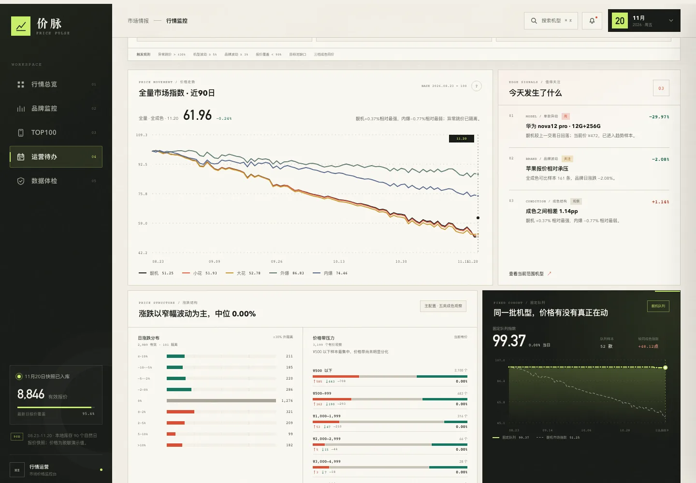
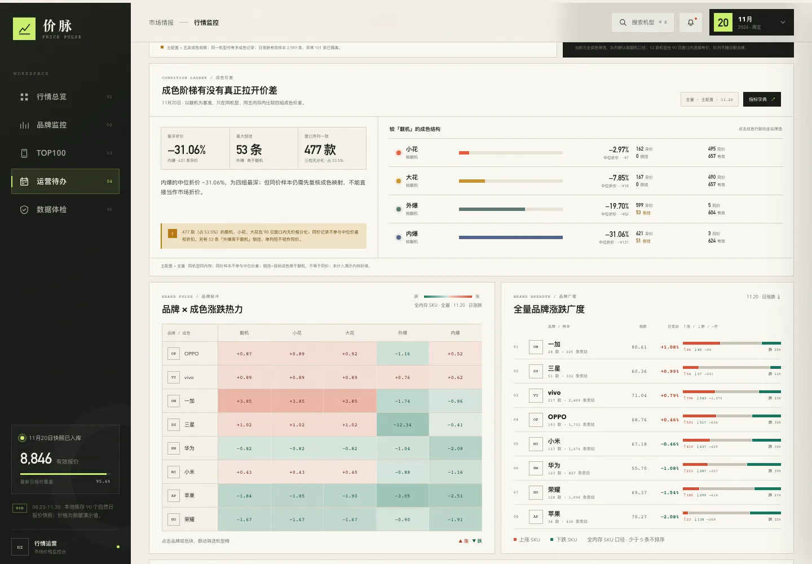
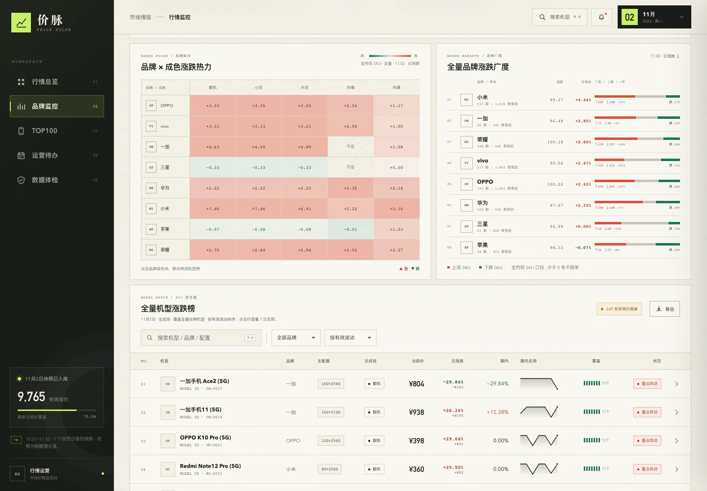
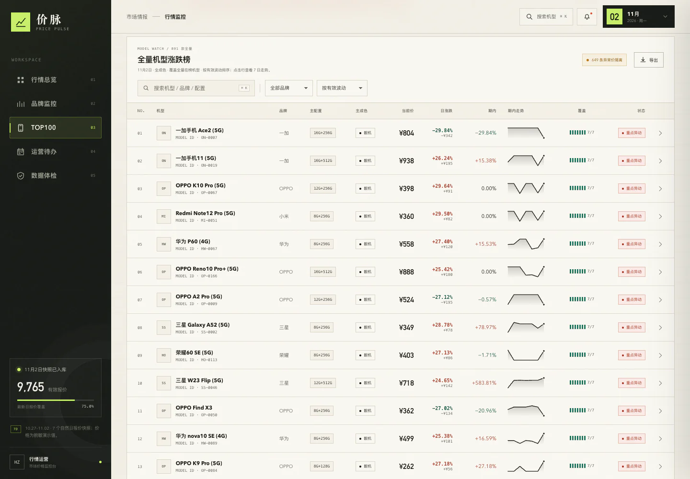
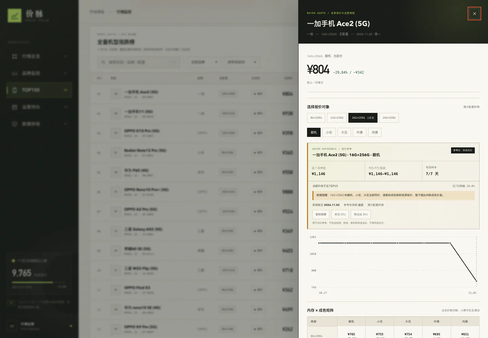
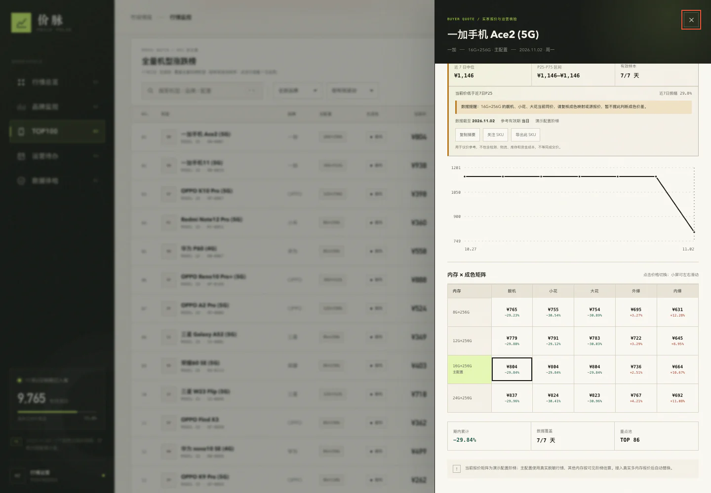
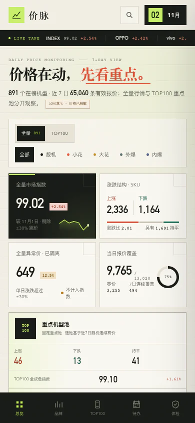

# 价脉 Price Pulse｜手机市场价格监控看板 PRD

> - 文档版本：v1.1（评审稿）
> - 更新日期：2026-11-16
> - 文档状态：业务、数据、产品、设计与研发可评审；研发排期前需完成接口、口径、权限和设计走查确认
> - 参考原型：https://hbicon.github.io/phone-market-price-monitor-preview/
> - 原型版本：Prototype 0.5
> - 数据基础：已提供的 7 日脱敏报价单；正式环境改为每日接口获取
> - 价格口径：市场参考价，非成交价、非结算价、非毛利价
> - 适用端：桌面 Web 为主，390px 移动端可读；公网仅发布脱敏演示数据

---

## 0. 文档信息

### 0.1 一页摘要

价脉把每天分散在报价单中的「机型 + 内存 + 成色 + 市场价」统一成可追溯的日快照，并以市场指数、涨跌广度、品牌监控、机型榜、成色价差和买家报价详情形成一条完整的判断链路：

1. 先确认数据是否新鲜、是否完整；
2. 再判断市场整体涨跌、品牌强弱和重点机型异动；
3. 进一步定位到机型、内存和成色；
4. 最后进入单个 SKU，读取当前价、近 7 日中位价、P25–P75、有效样本和所在位置；
5. 运营将异常和缺口转成可关闭的待办，买家将参考价转成可复制的报价摘要。

本期核心不是做交易系统，而是让运营和买家基于同一套可解释、可追溯的价格事实做判断。所有页面、接口和导出必须遵守同一唯一键与同一数据版本。

### 0.2 修订记录

| 版本 | 日期 | 变更内容 | 状态 |
|---|---|---|---|
| v1.0 | 2026-11-14 | 完成产品定位、7 日数据方案、指标口径、功能需求、异常状态和交付阶段 | 方案评审稿 |
| v1.1 | 2026-11-16 | 补齐正式 PRD 结构；新增 8 张价格展示 UI 截图、逐页字段与交互规范、价格格式、组件状态矩阵、UI 自检及验收清单；明确演示数据冻结与真实接口替换边界 | 评审稿 |

### 0.3 演示数据说明：为什么当前会看到“没值”

当前公网原型的数据窗口是 **2026-10-27 至 2026-11-02**。原型没有接入每日更新，因此截至本文档更新日 2026-11-16，11-03 之后不会自动出现新的行情值。这是演示数据已经冻结，不是指标计算丢失，也不是某个筛选条件把价格清零。

正式产品必须把“数据新鲜度”做成一级状态，而不是只在页脚写更新时间。具体规则如下：

1. 没有报价显示“—”，不补昨天的价格；
2. 零价显示“零价/未报”，不当作有效市场价；
3. 没有可比较的相邻两日报价，不计算涨跌幅；
4. 品牌或成色样本少于 5 条，显示“样本不足”；
5. 批次过期时显示“数据已过期”提示，同时保留最后一次成功发布的快照；
6. 接口失败时展示最后一次成功数据及时间，不清空整页；
7. 演示站必须持续显示数据窗口，避免把 11-02 的静态快照误认为 11-16 的实时行情。

---

## 1. 产品定义

### 1.1 一句话定位

面向手机回收、竞拍和报价业务，把每天分散在报价表单中的机型、内存、成色和市场价，变成一套可追溯、可比较、可行动的市场价格监控系统。

它回答四个问题：

- 今天市场整体在涨还是在跌？
- 哪些品牌、哪些机型、哪些成色在发生变化？
- 当前价格与近 7 日中位价、价格区间相比处在什么位置？
- 这组数据是否可信，异常和缺口由谁处理？

### 1.2 业务背景

当前每天会产出一份 TOP1000 机型成色报价数据，核心字段为：

- 机型
- 内存
- 成色
- 市场价

成色固定为靓机、小花、大花、外爆、内爆五类。业务方需要按天观察市场整体、品牌和单机型的价格变化，同时让采购、报价和运营使用同一套参考价，减少在 Excel、群消息和人工汇总之间来回切换。

当前已有 7 日报价结构验证：891 款机型、2,604 个内存配置；最新日 13,020 个唯一键，其中 9,765 条有价、3,255 条零价，有价率约 75%。这些数字用于验证产品和数据口径，不作为长期固定值。

### 1.3 产品目标

| 层级 | 目标 | 衡量方式 |
|---|---|---|
| 业务目标 | 每日开盘前看清市场方向与重点异动 | 行情简报可替代人工 Excel 汇总；运营能在 2 分钟内定位主要变化 |
| 数据目标 | 同一指标在页面、导出和接口中口径一致 | 页面值与指标 SQL / API 结果一致；同一日期同一 SKU 只有一个确认价 |
| 运营目标 | 异常、缺价、同价映射问题有处理入口 | P0/P1/P2 待办可定位、可核验、可关闭 |
| 买家目标 | 报价时能看到参考价、区间和样本量 | 详情页可直接复制 SKU 摘要，不把参考价误当成交价 |
| 交付目标 | 先接表单，后接日更 API | 接口切换不改变页面口径和用户操作 |

### 1.4 本期不做什么

- 不做成交、库存、毛利、资金成本的核算；
- 不承诺市场价就是成交价；
- 不在公网评审站展示真实原始价格；
- 不做自动定价或自动调价；
- 不把缺失报价推断成降价；
- 不先做复杂预测模型，先把可解释的日报监控闭合。

---

## 2. 用户与使用场景

| 用户 | 核心任务 | 使用频率 | 关注内容 |
|---|---|---|---|
| 行情运营 | 判断市场方向、品牌强弱、机型异动 | 每日开盘前 | 指数、涨跌广度、异常、待办、简报 |
| 采购/报价人员 | 查看某个 SKU 的参考价和波动区间 | 每次报价前 | 当前价、近 7 日中位价、P25–P75、成色价差 |
| 数据运营 | 检查批次是否完整、异常是否可解释 | 每日入库后 | 有价率、缺内存、重复键、异常跳价、上游批次状态 |
| 业务负责人 | 看市场趋势和品牌结构 | 每日/每周 | 市场指数、品牌排名、TOP100、固定队列 |
| 产品/指标负责人 | 统一指标定义和责任人 | 版本迭代 | 指标字典、公式、来源、新鲜度、血缘 |

### 2.1 关键用户故事

**行情运营**

> 作为行情运营，我希望打开页面先看到“今天发生了什么”，再按品牌或机型下钻，这样不用先看一堆明细表。

**采购/报价人员**

> 作为报价人员，我希望在同一个 SKU 上同时看到靓机、小花、大花、外爆、内爆的价格，以及近 7 日区间，这样能给客户一个有依据的参考价。

**数据运营**

> 作为数据运营，我希望在发布前知道今天哪些 SKU 零价、缺内存或跳价超过阈值，并能看到批次是否成功入库，避免把脏数据发到业务群。

**业务负责人**

> 作为负责人，我希望区分全市场和 TOP100 重点池，避免长尾机型掩盖重点机型的变化。

---

## 3. 产品结构

### 3.1 信息架构

| 层级 | 模块 | 解决什么问题 | 关键内容 | 主要操作 |
|---|---|---|---|---|
| 01 | 行情总览 | 今天市场是否在变 | 市场指数、涨跌广度、异常率、有价率 | 切换日期、范围、成色 |
| 02 | 7 日行情简报 | 用一段话说什么值得看 | 方向、广度、品牌强弱、异动、数据质量、P0/P1/P2 建议 | 复制简报、跳转待办 |
| 03 | 运营待办 | 异常如何闭环 | 异常跳价、机型异动、品牌异动、缺价、目标池缺口、成色同价 | 筛选、打开详情、标记核验 |
| 04 | 价格走势 | 趋势是否持续 | 市场指数、成色指数、固定队列与市场指数对比 | 切换成色、查看日期 |
| 05 | 价格结构 | 涨跌分布和价格带在哪里 | 九档涨跌分布、六段价格带、样本量 | 查看承压价格带 |
| 06 | 成色价差 | 成色阶梯是否真实拉开 | 小花/大花/外爆/内爆相对靓机的价差、折扣、倒挂、同价 | 点击成色联动筛选 |
| 07 | 品牌监控 | 哪个品牌在变 | 品牌 × 成色热力、品牌涨跌广度 | 点击品牌/色块联动机型榜 |
| 08 | TOP100/机型榜 | 哪个机型在变 | 搜索、排序、覆盖、期内变化、CSV 导出 | 打开详情、关注 SKU、导出 |
| 09 | 机型详情 | 买家和运营看同一个 SKU | 当前价、日变化、7 日区间、内存 × 成色矩阵 | 切换内存/成色、复制摘要 |
| 10 | 数据体检 | 数据是否可信 | 7 日有效记录、匹配率、缺内存、异常、覆盖时间线 | 切日期、查看口径 |
| 11 | 指标字典与血缘 | 口径为什么这样算 | 定义、公式、来源、频率、责任角色、血缘链路 | 查询、评审、追责 |

### 3.2 首屏阅读顺序

1. **数据是否新鲜**：批次日期、更新时间、有价率；
2. **市场方向**：指数、日涨跌、涨跌广度；
3. **重点变化**：异常、TOP100、品牌强弱；
4. **可执行动作**：P0/P1/P2 待办和简报；
5. **下钻明细**：机型榜、成色矩阵、买家参考。

这个顺序不能反过来。用户先知道“能不能用”，再看“发生了什么”，最后才看“哪个 SKU”。

---

## 4. 价格展示 UI 设计与验收规范

> 本节截图来自 Prototype 0.5 的桌面端 `1440 × 1000` 和移动端 `390 × 844`。截图价格均为公网脱敏演示值，数据窗口冻结在 `2026-10-27` 至 `2026-11-02`；截图中的具体价格不构成业务真实报价，也不改变本文定义的计算口径。

### 4.1 设计目标与边界

价格展示不是把 Excel 搬到网页上，而是帮助用户完成四个连续判断：

| 判断 | 用户问题 | 对应界面证据 | 不满足时的后果 |
|---|---|---|---|
| 能不能用 | 这批数据是否最新、是否完整 | 数据窗口、更新时间、有价率、异常率 | 旧价格被当成今日价 |
| 往哪走 | 市场、品牌、机型在涨还是跌 | 指数、涨跌广度、趋势、品牌热力 | 只能逐条看价格，无法形成方向感 |
| 为什么变 | 是哪个品牌、机型、成色或价格带在变 | 结构分布、成色价差、品牌和机型榜 | 看见变化但无法定位原因 |
| 怎么用 | 这个 SKU 当前处在什么位置 | 当前价、近 7 日中位、P25–P75、样本和价格位置 | 参考价缺少区间与可信度 |

设计约束：

- **先可信、后好看**：数据新鲜度和样本状态优先于图表表现；
- **先聚合、后明细**：从市场方向进入品牌、机型，再进入 SKU，不让用户先面对 1 万多行明细；
- **同口径联动**：日期、全量/TOP100、成色、品牌只维护一份筛选状态，所有模块同步重算；
- **参考价不越界**：任何面向买家或对外复制的价格，固定标注“参考价 · 非成交价”；
- **不用空缺代替解释**：缺失、零价、无可比、样本不足和异常使用不同文案与状态，不能一律显示 0；
- **不只用颜色传义**：涨跌同时使用正负号、箭头或文字；热力色块内部始终保留数值；
- **异常可定位、不可污染**：异常价仍可在明细中核验，但不进入指数、趋势、结构分布和品牌强弱结论。

### 4.2 页面清单与评审范围

| 编号 | 页面/状态 | 截图 | 主要用户 | 本期优先级 |
|---|---|---|---|---|
| UI-01 | 行情总览 | `01-overview.png` | 行情运营、业务负责人 | P0 |
| UI-02 | 价格走势与价格结构 | `02-price-structure.png` | 行情运营、数据运营 | P0 |
| UI-03 | 成色价差 | `03-condition-spread.png` | 行情运营、数据运营 | P1 |
| UI-04 | 品牌监控 | `04-brand-monitor.png` | 行情运营、业务负责人 | P0 |
| UI-05 | TOP100 / 全量机型榜 | `05-model-ranking.png` | 行情运营、采购/报价 | P0 |
| UI-06 | 买家报价详情 | `06-buyer-quote-drawer.png` | 采购/报价人员 | P0 |
| UI-07 | 内存 × 成色矩阵 | `07-memory-condition-matrix.png` | 采购/报价人员 | P0 |
| UI-08 | 移动端行情总览 | `08-mobile-overview.png` | 移动办公、门店报价 | P1 |

### 4.3 全局界面框架

**桌面端**

- 左侧导航固定承载「行情总览、品牌监控、TOP100、运营待办、数据体检」，当前页面只能有一个选中态；
- 顶部保留机型搜索、数据提醒和业务日期切换；日期切换必须改变全站数据，不只改变右上角日期字样；
- 品牌快报带只用于快速感知，不作为精确报价依据；完整值必须能在下方模块中查到；
- 所有筛选在内容区顶部集中呈现，避免每个卡片拥有不同日期口径；
- 页面背景使用低对比纸张色，价格与状态使用更高对比层级；图表网格不抢数字；
- 底部固定展示报价参考边界与原型/数据版本，保证截图或导出后仍能识别口径。

**移动端**

- 保留侧栏中的五个一级入口，转为底部导航；
- 顶部只保留品牌、搜索、日期，避免挤压首屏价格信息；
- 首屏保留数据新鲜度、筛选、市场指数、涨跌广度、异常和有价率；
- 表格不强行压缩所有列，次要列隐藏并允许横向滑动；
- 抽屉在移动端占满屏幕，价格、成色切换和报价参考置于首屏；
- 所有点击区域不小于 `44 × 44px`，不依赖 hover 展示关键信息。

**全局数据状态**

| 状态 | 必须可见的信息 | 不允许出现 |
|---|---|---|
| 正常 | 业务日期、发布时间、`data_version`、当前筛选 | 只写“更新时间”但不写日期 |
| 过期 | “数据已过期”、最后成功日期、继续展示的快照版本 | 静默展示旧值 |
| 部分可用 | 已发布但存在零价、缺内存或异常的数量 | 把部分数据说成完整 |
| 无批次 | “暂无已发布批次”及处理入口 | 全页 0、空白或 `undefined` |
| 接口失败 | 最后成功快照、失败提示、重试入口和发生时间 | 清空整页或伪装成 0 |

### 4.4 行情总览


**页面目标**：让运营在首屏 2 分钟内回答“数据能不能用、今天市场往哪走、哪里最值得处理”。

| 区域 | 价格与字段 | 展示规则 | 空值/异常 |
|---|---|---|---|
| 数据窗口 | `2026.10.27–11.02`、更新时间、批次状态 | 始终显示起止日期和最后发布时间 | 过期用琥珀提示；无批次显示“暂无批次” |
| 市场指数 | 当前指数 `99.02`、日变化 `+2.54%` | 基准日 `2026.10.27 = 100`；剔除单日 ±30% 异常 | 无可比样本显示“无可比”，不显示 0 |
| 涨跌广度 | 上涨 `2,336`、下跌 `1,164`、持平 `1,691`、涨跌比 `2.01` | 只统计相邻两日均有效且未隔离的 SKU | 分母为 0 时涨跌比显示“—” |
| 价格异常 | `649`、异常率 `12.5%` | 异常值保留在明细，但不进入聚合指标 | 标签固定说明“已隔离” |
| 报价覆盖 | 有价 `9,765` / 唯一键 `13,020`、有价率 `75.0%`、零价 `3,255` | 零价计入唯一键、不计为有效市场价 | 有价率低时不能解读为价格下跌 |
| TOP100 重点池 | 涨、跌、平、指数、期内累计、进入 100 款 | 固定重点池单独计算，不与全量混合 | 池成员不足时显示缺口，不临时补位 |
| 行情简报 | 方向、7 日累计、品牌强弱、异常、P0/P1/P2 | 结论必须由当前筛选和数据版本生成 | 数据不完整时先写数据限制，再写行情结论 |
| 运营待办 | 优先级、类型、对象、证据、处理入口 | 每项可跳到对应筛选、机型或数据体检 | 不能只有“异常”而没有处理入口 |

**交互**

1. 切换日期、全量/TOP100、成色后，指数、结构、TOP100、简报和待办同步刷新；
2. 点击 TOP100 摘要进入完整 100 款榜单，并保留当前日期和成色；
3. 点击简报中的品牌或机型，进入对应筛选结果；
4. 复制简报时，同时复制数据窗口、样本约束、异常隔离说明和“参考价 · 非成交价”。

**验收点**

- 首屏不滚动即可看到数据窗口、有价率和至少一项市场方向指标；
- 异常数量、零价数量与有价率之间有可解释的算术关系；
- 所有卡片在同一筛选下使用同一 `data_version`；
- 任何值缺失都不会显示 `0`、`NaN`、`undefined` 或纯空白。

### 4.5 价格走势与价格结构



**页面目标**：判断变化是否持续、涨跌集中在哪些幅度与价格带，并区分“市场动了”与“某一批样本动了”。

| 模块 | 展示字段 | 规则 |
|---|---|---|
| 价格走势 | 全量/TOP100、成色、日变化、7 日折线、基准日、异常隔离说明 | 基准日指数为 100；每个点对应一个已发布日期 |
| 涨跌分布 | 九档：`<−10%`、`−10%～−5%`、`−5%～−2%`、`−2%～0%`、`0%`、`0%～2%`、`2%～5%`、`5%～10%`、`>10%` | 展示样本数与占比；`±30%` 外异常不进入分布 |
| 价格带 | `<¥500`、`¥500–999`、`¥1,000–1,999`、`¥2,000–2,999`、`¥3,000–4,999`、`¥5,000+` | 每段显示有效样本、中位变化、异常/无可比说明 |
| 固定队列 | 队列指数、队列样本、与同成色市场指数差值 | 队列成员按同一批机型固定，不随日期洗牌；按每日中位涨跌复利 |
| 右侧事件轨 | 机型异动、品牌异动、成色异动、当前范围入口 | 事件按重要度排序；点击可定位详情或筛选 |

**交互**

- hover/focus 折线点显示日期、指数、日变化和有效样本；
- 点击日期、图例或事件，不改变页面筛选之外的其他维度；
- 九档和六段即使无样本也保留层级位置，显示 `0` 或“无可比”，保证分布结构可比较；
- 移动端保留折线和总量，结构可折叠，不把标签堆叠成不可读状态。

**验收点**

- 折线点的日期与所选业务日期一致；
- 涨跌九档的样本总和与当前口径有效样本对得上；
- 异常价不进入趋势和结构，但在异常入口可找到；
- 固定队列成员与样本数稳定，不因日期切换替换成员。

### 4.6 成色价差



**页面目标**：判断小花、大花、外爆、内爆相对靓机是否真实拉开价差，并优先识别同价映射问题。

| 字段 | 展示规则 | 业务解释 |
|---|---|---|
| 比较基准 | 同日、同机型、同内存的靓机价 | 跨内存、跨日期不可比 |
| 目标成色 | 小花、大花、外爆、内爆 | 四组成色分别计算 |
| 价差 | `P目标 − P靓机` | 负数表示低于靓机，正数表示倒挂 |
| 折扣 | `P目标 / P靓机 − 1` | 中位折扣不是平均折扣 |
| 有效异价样本 | 目标价与靓机价均有效且不相等 | 进入中位价差和中位折扣 |
| 同价样本 | `P目标 = P靓机` | 单列，不进入中位价差 |
| 倒挂 | `P目标 > P靓机` | 独立计数，不并入下跌或同价 |
| 7 日序列一致 | 靓机、小花、大花连续 7 日完全相同 | 作为映射复核信号，不当作真实无差价结论 |

**当前截图数据仅用于说明**：演示快照中全量有 `498 款`、约占 `55.9%` 的机型存在三档成色 7 日序列同价，`69 条`存在倒挂。正式发布时这些数字必须由最新 `data_version` 重新计算，不得写入静态文案。

**交互与验收**

- 点击成色行联动全站成色筛选，筛选状态可见、可清除；
- 同价提示必须与中位价差同屏出现，避免用户只看折扣；
- 倒挂和同价不能因样式弱化而消失；
- 样本不足时显示“样本不足”，不计算中位结论；
- 主配置与全内存口径必须明确标注，不能混合展示。

### 4.7 品牌监控



**页面目标**：从品牌层判断强弱，并定位是哪个成色在带动变化。

**品牌 × 成色热力**

- 单元格展示日涨跌幅，正值红色、负值绿色，同时保留正负号和数值；
- 颜色只表达方向与强度，不替代数字；
- 可比样本少于 5 条时显示“不足”，不使用接近 0 的伪数值；
- 点击品牌或色块联动筛选机型榜，并能看到当前筛选条件；
- 热力只反映有效 SKU，异常和不完整样本不进入。

**品牌涨跌广度**

- 展示品牌、指数、日变动、上涨/下跌/持平数量、可比样本和下跌面；
- 排序默认按日变动，可切换为样本量或下跌面；
- 品牌指数不能解释为该品牌所有机型的平均价格；
- 样本不足的品牌保留在列表但置底，不参与强弱排名。

**验收点**

- 点击任一色块后，机型榜品牌和成色筛选一致；
- 单元格值、品牌排行中的日变动与当前日期口径一致；
- 样本不足、异常隔离和颜色图例均有文本说明；
- 1080px 以下允许热力横向滚动，不压缩数字到不可读。

### 4.8 TOP100 与全量机型榜



**页面目标**：定位当前价格变化最大的机型，并进入单一 SKU 核验。

| 列 | 展示规则 | 空值/异常 |
|---|---|---|
| 排名 | 当前榜单名次，与重点池固定名次分开 | 无有效价格不参与当前价排名 |
| 机型 | 标准机型名、`model_id`、品牌、主配置、主成色 | 映射失败显示待映射，不按名称猜测 |
| 当前价 | `¥804` 千分位格式 | 零价显示“零价/未报”，缺失显示“—” |
| 日涨跌 | `−29.84%` / `−¥342` | 无可比显示“—”，不能显示 `0%` |
| 期内变化 | 当前日期相对窗口首日的累计变化 | 窗口不完整时显示覆盖限制 |
| 7 日走势 | 小型折线，不含异常点 | 缺失日断点，不补零 |
| 覆盖 | `7/7` 等 | 少于目标覆盖显示原因 |
| 状态 | 正常、重点异动、异常隔离、覆盖不足、样本不足 | 状态不能只靠颜色 |

**排序与导出**

- 支持有效波动、有效涨幅、有效跌幅、异常优先、价格和重点池名次；
- 默认排序不把隔离异常混入“有效波动”；
- 导出字段、行数、当前筛选、数据版本与页面保持一致；
- 导出文件包含“参考价 · 非成交价”和生成时间；
- 点击行打开买家报价详情，键盘 Enter/Space 等效。

**验收点**

- TOP100 切换后能查看完整 100 款，排名与筛选可恢复；
- 异常行有单独状态入口，不能伪装成正常涨跌；
- 当前价、日涨跌、期内变化和走势使用同一 SKU 与同一数据版本；
- 无结果时说明“无符合筛选的机型”，并提供清除筛选。

### 4.9 买家报价详情



**页面目标**：让采购/报价人员在一个可解释的价格上下文中完成议价参考，而不是只读一个孤立的当前价。

| 区域 | 字段 | 规则 |
|---|---|---|
| 价格头 | 机型、品牌、内存、日期、当前价、日变化、金额变化 | 必须同时给出价格和“较上一交易日” |
| 报价对象 | 内存按钮、成色切换 | 切换后所有价格、区间、矩阵选中态同步 |
| 近 7 日中位 | `¥1,146` | 仅使用当前 SKU 的有效日价格；缺失日不补 |
| P25–P75 区间 | `¥1,146–¥1,146` | 有效样本不足时区间显示“样本不足” |
| 有效样本 | `7/7 天` | 同时展示样本天数与总窗口，避免只看一个比值 |
| 价格位置 | 低于 P25 / 区间内 / 高于 P75 | 返回文本，不只显示颜色；无可比时明确说明 |
| 近 7 日振幅 | `29.8%` | 仅在有效价格足够时计算 |
| 风险提示 | 同价映射、异常隔离、缺日、样本不足 | 放在价格附近，不只放在页脚 |
| 操作 | 复制摘要、关注 SKU、导出当前 SKU | 复制内容必须带日期、样本、参考价声明 |

**交互**

- 抽屉打开后焦点进入关闭按钮，`Esc` 可关闭，关闭后焦点回到触发机型；
- 背景内容通过 `inert` 隔离，避免键盘误操作；
- 切换内存或成色时，标题、当前价、区间、图表、矩阵和操作对象一起更新；
- “关注 SKU”必须明确反馈成功/失败，不能只改变按钮样式；
- 复制摘要和导出失败时有可操作错误提示，不静默失败。

**验收点**

- 6 个价格字段能追溯到同一个 `model_id + memory + condition + business_date`；
- 同价、异常、缺日和样本不足在抽屉内均可解释；
- 当前价、近 7 日中位、P25–P75、有效样本和图表不出现互相矛盾的数值；
- “参考价 · 非成交价”在首屏可见，复制和导出后仍存在。

### 4.10 内存 × 成色矩阵



**页面目标**：在一个机型内快速比较不同内存、不同成色的当前价，避免跨页面反复查询。

| 元素 | 规则 |
|---|---|
| 行 | 标准内存，主配置有固定标识；行可点击切换当前报价对象 |
| 列 | 靓机、小花、大花、外爆、内爆，顺序不可变 |
| 单元格 | `¥804` + 日涨跌；选中态同时有边框、底色与 `aria-pressed` |
| 空单元 | 显示“—”或“暂无报价”，不显示 `¥0` |
| 异常单元 | 保留价格并标记异常，不能混入普通涨跌色 |
| 演示数据 | 非主配置若为 synthetic-demo，必须在矩阵附近说明，正式接入后移除 |

**移动端**

- 表头与首列保持可识别，价格区域允许横向滑动；
- 单元格不压缩到无法阅读，优先保证价格和日涨跌；
- 点击价格后当前 SKU 与上方参考价区域同步；
- 键盘用户可用 Tab 进入单元格，用 Enter/Space 选中。

### 4.11 移动端行情总览



**页面目标**：在手机上仍能完成“确认日期 → 看方向 → 看重点池 → 进入全量名单”的最小闭环。

**移动端展示顺序**

1. 品牌、搜索、业务日期；
2. 数据窗口与有价率；
3. 全量/TOP100 与成色筛选；
4. 市场指数、涨跌结构；
5. 异常和报价覆盖；
6. TOP100 摘要；
7. 简报与待办；
8. 品牌、机型、详情和定价信息。

**验收点**

- 390px 宽度无页面级横向溢出；
- 首屏能看到日期、有价率和至少一个市场方向指标；
- 底部导航不遮挡最后一块内容，并提供足够底部安全区；
- 详情抽屉全屏，关闭按钮固定可见；
- 表格与矩阵只在各自容器内横滑，不带动整个页面横移。

### 4.12 价格、涨跌与样本的展示规范

| 数据场景 | 标准展示 | 说明 |
|---|---|---|
| 正常正价 | `¥1,146` | 千分位、默认整数；原始数据有小数时才保留对应精度 |
| 零价 | `零价/未报` | 不使用 `¥0`，不计入有效市场价 |
| 缺失 | `—` | 不补昨天、不补同品牌均价 |
| 上涨 | `+2.54%`、`+¥135`、`▲` | 红色；正号必显 |
| 下跌 | `−29.84%`、`−¥342`、`▼` | 绿色；使用负号而非括号 |
| 持平 | `0.00%`、`—` 金额变化 | 与“无可比”明确区分 |
| 无可比 | `无可比` | 不显示 `0%`，不进入涨跌广度 |
| 异常 | `异常 · 已隔离` | 价格可查，不进入指数、趋势和排行 |
| 样本不足 | `样本不足` | 少于 5 条有效样本，不做强弱结论 |
| 数据过期 | `数据已过期 · 截至 11.02` | 保留最后快照，同时提示追批 |
| 数据加载 | 骨架屏 + “正在加载” | 不先显示 0 再跳变 |
| 参考价声明 | `参考价 · 非成交价` | 详情、导出、简报和图表脚注固定出现 |

格式化规则：

- 货币统一使用人民币符号和千分位；不要在同一个页面混用 `元`、`块`、`¥`；
- 百分比统一保留 2 位小数，正数带 `+`，负数使用 `−`（U+2212）；
- 金额变化与百分比变化分开呈现，不能只给百分比让用户反推；
- 分子为 0、分母为 0 或样本不足时返回明确状态，不执行除法；
- 表格数字右对齐，价格和涨跌使用等宽数字特性；
- 复制到聊天工具或 CSV 时保留值的语义和缺失状态，不把 `—` 转成空字符串。

### 4.13 组件状态矩阵

| 状态 | 触发条件 | 价格区 | 涨跌区 | 图表/结构 | 用户动作 |
|---|---|---|---|---|---|
| 正常 | 当前批次已发布且样本充足 | 正常价格 | 正常涨跌 | 正常绘制 | 查看、复制、导出 |
| 加载中 | 首次加载或切换日期 | 骨架 | 骨架 | 骨架 | 等待，可取消 |
| 空结果 | 筛选无匹配 | 无结果说明 | — | 空状态图 | 清除筛选 |
| 零价 | `market_price = 0` | `零价/未报` | `—` | 排除 | 补价/核验 |
| 缺价 | 无唯一键记录 | `—` | `—` | 断点 | 补价 |
| 无相邻日 | 当日或前一日无有效价 | 正常显示当前价（若有） | `无可比` | 只画有效点 | 等下一日/核验 |
| 样本不足 | 有效样本 < 5 | 显示价格 | `样本不足` | 不画结论线 | 扩大范围 |
| 异常跳价 | 单日变化 > ±30% | 显示价格 | `异常 · 已隔离` | 不进入聚合 | P0 核验 |
| 过期 | 距最后发布 > 24h | 显示快照价 | 保留最后值 | 保留快照 | 追批 |
| 接口失败 | 请求错误或超时 | 最后成功快照 | 最后成功值 | 旧快照 + 时间 | 重试 |
| 无权限 | 角色无价格/导出权限 | 权限提示 | 隐藏 | 隐藏敏感值 | 申请权限 |

### 4.14 交互与可访问性

- 所有价格都可被读屏识别为货币，不依赖图形；图表提供文本摘要或数据表替代；
- 焦点顺序与视觉顺序一致，抽屉、弹窗关闭后焦点回到触发点；
- 状态同时使用文字、符号和颜色，色盲模式下仍能区分涨跌与异常；
- hover 信息必须能通过 focus 或点击获得，触屏不存在“只有悬停才能看”的关键数据；
- 日期和筛选变更时给出轻量加载反馈，但不频繁弹出 Toast；
- 数字变化不使用自动滚动计数，避免用户误读价格；
- 同一页面中只允许一个 `aria-current="page"`；
- 对比度满足 WCAG 2.2 AA，交互目标不小于 44px；
- 导出按钮文案说明范围，例如“导出当前筛选 891 款”，而非模糊的“导出”。

### 4.15 UI 自检结论

**结论：当前 UI 已满足市场价格监控评审所需的 P0 信息框架，可进入业务与研发评审；但不能直接视为生产可用。**

| 检查项 | 结论 | 证据/说明 |
|---|---|---|
| 是否先判断数据可信 | 通过 | 数据窗口、有价率、异常率和数据体检均在一级路径 |
| 是否先聚合再下钻 | 通过 | 首屏指数/广度 → 品牌 → 机型 → SKU 详情 |
| 是否能按天观察 | 通过（演示） | 7 个日期共用重算逻辑；正式版需接每日 API |
| 是否区分全量与 TOP100 | 通过 | 两套口径独立展示，TOP100 有固定池说明 |
| 是否暴露零价与异常 | 通过 | 零价、异常隔离、同价映射均可见 |
| 是否避免把参考价当成交价 | 通过 | 详情、简报、导出、页脚均有声明 |
| 是否有买家报价上下文 | 通过 | 中位、P25–P75、样本、位置、振幅与矩阵齐全 |
| 是否色彩可辨 | 通过（需回归） | 红涨绿跌 + 符号/数值；渐变区域仍需对比度回归 |
| 是否移动可读 | 通过 | 390px 首屏、底部导航、容器内横滑 |
| 是否可直接生产 | 未通过 | 缺少实时接口、真实全内存报价、服务端待办和权限审计 |
| 数据是否实时 | 未通过（已知限制） | 演示数据冻结在 2026-11-02，必须在评审时明确 |

**本轮已修复的展示问题**：

- 修复部分指标字典单元格在宽屏下换行错位；
- 成色价差截图补齐模块标题上沿，避免被误读为独立卡片；
- 重截移动端首屏，确保从页面顶部开始而不是截到页面中部；
- 对“没值”补充数据窗口与冻结说明，避免误判为计算故障。

**仍待正式版补齐**：

- 每日批次接入后的自动新鲜度横幅和追批入口；
- 真实全内存报价替换 synthetic-demo 演示阶梯；
- 服务端待办、异常复核、审计与权限；
- 任意历史区间、同环比、告警订阅和指标重算记录。

### 4.16 UI 验收清单

- [ ] 8 张评审截图均可在仓库内打开，图片路径有效；
- [ ] 首屏在 1440×1000 和 390×844 下无页面级横向溢出；
- [ ] 日期、范围、成色、品牌变更后所有模块使用同一数据版本；
- [ ] 当前价、日涨跌、期内变化、中位、区间与样本均可追溯到唯一 SKU；
- [ ] 零价、缺价、无可比、样本不足、异常、过期和接口失败均有独立状态；
- [ ] 每张含价格页面均展示“参考价 · 非成交价”；
- [ ] 红涨绿跌同时有符号/文字，异常色不与涨跌色混用；
- [ ] 详情抽屉键盘可进入、可关闭、关闭后焦点正确返回；
- [ ] 移动端首屏保留数据新鲜度、核心指标和筛选；
- [ ] 导出内容与当前筛选、页面值、数据版本一致，且包含免责声明。

---

## 5. 数据方案

### 5.1 当前表单数据与标准字段

当前表单/Excel 作为第一期数据源，正式环境改为每日接口。标准字段建议如下：

| 字段 | 类型 | 必填 | 说明 |
|---|---|---|---|
| `business_date` | date | 是 | 报价业务日期，不使用入库时间替代 |
| `model_id` | string | 是 | 稳定机型 ID，不用机型名称作为主键 |
| `model_name` | string | 是 | 机型展示名，例如 iPhone 15 Pro |
| `brand` | string | 是 | 品牌标准名，例如 苹果、华为、小米 |
| `memory` | string | 是 | 标准内存，例如 128G、256G、512G、1T |
| `condition` | enum | 是 | 靓机、小花、大花、外爆、内爆 |
| `market_price` | decimal | 是 | 市场报价，允许 0，0 表示零价/未报，不表示成交 0 元 |
| `quote_source` | string | 否 | 报价来源或渠道，默认取批次来源 |
| `source_updated_at` | datetime | 否 | 上游实际更新时间 |

补充说明：

- “市场价”是业务参考价，不是成交价、结算价或毛利价；
- 同一机型不同内存是不同 SKU，必须分别报价；
- 价格是 SKU 的属性，不能参与唯一键；
- 机型名称可以变，但 `model_id` 必须稳定；
- 如果上游无法提供 `model_id`，需要先建立机型名称到 ID 的映射，不允许直接按名称猜。

### 5.2 唯一键和重复值处理

唯一键定义为：

```text
business_date + model_id + memory + condition
```

业务方已确认：源侧会单独计算价格，保证同一天、同一 `model_id + memory + condition` 只有一个市场价。系统不承担二次取平均或挑选某一条报价的职责；接入层的职责是验证该约束、记录批次并在违反时阻断发布。

业务规则：

1. 同一天、同一机型、同一内存、同一成色只允许一个确认价；
2. 上游已经计算好唯一价，接口不应重复传多条；重复只可作为错误暴露，不能作为价格聚合输入；
3. 如果同一唯一键出现多条，**整个批次阻断发布**，不能静默取平均值、最后一条或第一条；
4. 运营在“数据体检”中看到冲突键和原始批次，确认后重新提交；
5. 新批次覆盖同一天数据时，必须生成新批次号、填写覆盖原因并留下审计记录，不做无痕覆盖。

这条规则是行情可信度的底线。价格可以被修正，但不能悄悄改变。

### 5.3 数据分层

```text
日报表单 / 每日 API
        ↓
ODS 原始批次（原样留存）
        ↓
DWD 标准报价明细（字段标准化、唯一键、质量标记）
        ↓
DWS 日快照 / 机型 / 品牌 / 成色聚合
        ↓
ADS 指标与页面查询接口
        ↓
行情看板 / 买家报价 / 数据体检
```

| 层 | 内容 | 保留要求 |
|---|---|---|
| ODS | 原始文件或 JSON，保留 `batch_id`、上传人、哈希 | 至少 1 年，便于回溯 |
| DWD | 标准报价事实表，每 SKU 每日一行 | 至少 2 年 |
| DWS | 每日市场/品牌/成色/机型聚合快照 | 至少 2 年 |
| ADS | 看板指标和缓存，可按发布版本重算 | 可重建，不单独作为事实源 |

### 5.4 批次状态

| 状态 | 含义 | 页面行为 |
|---|---|---|
| `received` | 已接收，尚未校验 | 不更新看板 |
| `validating` | 正在校验唯一键、字段和口径 | 显示“入库校验中” |
| `published` | 校验通过，已成为当前快照 | 更新看板和指标 |
| `failed` | 阻断项未解决 | 保留上一版，展示失败原因 |
| `superseded` | 已被新的修正批次替代 | 历史可查，不再作为当前值 |

批次发布必须是原子操作：校验失败时上一批数据继续服务，不允许出现半天旧数据、半天新数据的混合快照。

### 5.5 数据质量门禁

以下阈值是建议初值，正式上线前由数据运营确认并在后台配置。

| 级别 | 规则 | 处理 |
|---|---|---|
| 阻断 | 缺少日期、机型 ID、内存、成色、价格 | 整批不发布 |
| 阻断 | 同一唯一键重复 | 整批不发布，列出冲突键 |
| 阻断 | 价格不是数值或为负数 | 整批不发布 |
| 阻断 | 有效唯一键数低于近 7 日均值的 70% | 整批不发布，防止空批次覆盖 |
| 警告 | 有价率低于 80% | 可以发布，需负责人确认 |
| 警告 | 缺内存记录大于 0 | 隔离记录并展示数量 |
| 警告 | 单日涨跌超过 ±30% | 进入异常清单，不进入指数/趋势 |
| 警告 | 靓机、小花、大花完整序列同价 | 标记成色映射复核，不直接当作真实折价 |
| 警告 | 目标池少于 1,000 款 | 进入目标池缺口待办 |

首版建议把“阻断项”设为不可配置风险，把“警告”设为可配置阈值。

---

## 6. 接口方案

### 6.1 写入接口：每日报价批次

正式环境不再由前端上传文件，而是由数据源每日推送或由调度任务拉取。

```http
POST /open-api/v1/quote-batches
Content-Type: application/json
X-App-Id: price-pulse-data
X-Timestamp: 1793866569
X-Nonce: 2f3a...
X-Signature: hmac-sha256(...)
Idempotency-Key: 20261102-quote-001
```

请求体示例：

```json
{
  "batch_date": "2026-11-02",
  "source": "daily-quote-form",
  "source_updated_at": "2026-11-02T18:06:00+08:00",
  "quotes": [
    {
      "model_id": "AP-0033",
      "model_name": "iPhone XS",
      "brand": "苹果",
      "memory": "512G",
      "condition": "靓机",
      "market_price": 839
    },
    {
      "model_id": "AP-0033",
      "model_name": "iPhone XS",
      "brand": "苹果",
      "memory": "512G",
      "condition": "小花",
      "market_price": 806
    }
  ]
}
```

响应示例：

```json
{
  "batch_id": "qb_20261102_001",
  "status": "published",
  "business_date": "2026-11-02",
  "total": 13020,
  "valid": 9765,
  "zero": 3255,
  "rejected": 0,
  "coverage": 0.75,
  "published_at": "2026-11-02T18:10:12+08:00",
  "data_version": "2026-11-02.1"
}
```

接口约束：

- 使用 App ID + HMAC 签名，不接受匿名写入；
- `Idempotency-Key` 与 `payload_hash` 双重幂等；
- 同一天重复批次必须返回同一结果或明确的覆盖审批错误；
- 单次请求建议不超过 20,000 条；超过时拆批，使用同一 `batch_id` 汇总；
- 所有拒绝记录返回 `model_id`、`memory`、`condition`、错误码，不返回无意义的“失败”；
- 接口成功后，页面通过 `data_version` 判断是否需要刷新。

### 6.2 读取接口：看板与详情

| 接口 | 用途 | 关键参数 |
|---|---|---|
| `GET /api/v1/dashboard/overview` | 首屏指标、简报、待办摘要 | `date`、`scope`、`condition` |
| `GET /api/v1/dashboard/trends` | 市场/成色/固定队列趋势 | `date`、`scope`、`condition` |
| `GET /api/v1/dashboard/structure` | 涨跌分布、价格带、成色价差 | `date`、`scope`、`condition` |
| `GET /api/v1/brands` | 品牌热力和涨跌广度 | `date`、`scope`、`condition` |
| `GET /api/v1/models` | 机型列表、搜索、排序、分页 | `q`、`brand`、`sort`、`page` |
| `GET /api/v1/models/{model_id}/quote` | 单机型内存 × 成色报价与区间 | `date`、`memory`、`condition` |
| `GET /api/v1/data-quality` | 批次、覆盖、异常、缺内存和血缘状态 | `date` |
| `GET /api/v1/ops-tasks` | 运营待办和核验状态 | `date`、`status` |
| `GET /api/v1/metric-dictionary` | 指标定义、公式、责任人、新鲜度 | `version` |

读取接口统一返回：

```json
{
  "data_version": "2026-11-02.1",
  "business_date": "2026-11-02",
  "published_at": "2026-11-02T18:10:12+08:00",
  "freshness": "fresh",
  "data": {}
}
```

`freshness` 建议分为：

- `fresh`：已发布且未超过 24 小时；
- `stale`：超过 24 小时未更新；
- `missing`：没有可用批次；
- `partial`：批次已发布但存在隔离记录。

### 6.3 正式接入后的数据替换边界

当前原型有两类演示数据：

1. 主配置：真实脱敏行情，用于指数、品牌、成色价差；
2. 非主配置：按主配置生成的 synthetic-demo 内存阶梯，只用于演示详情抽屉。

正式接入后：

- 所有真实内存配置都来自接口，不再生成阶梯；
- 成色价差从“仅主配置”升级为“真实全内存配置”；
- 每个 `model_id + memory + condition` 都可独立比较；
- 页面增加“主配置 / 全内存”口径标识，默认展示全内存，关键指标支持切换；
- 指标字典中删除 synthetic-demo 标记，改为真实数据版本。

---

## 7. 指标口径

### 7.1 指标体系

| 指标 | 业务定义 | 计算公式 | 数据来源 | 更新频率 | 责任角色 |
|---|---|---|---|---|---|
| 市场指数 | 可比 SKU 的日价格变化中位数，复利成指数 | `I_t = I_{t-1} × (1 + median(ΔP/P_{t-1}))`，基准日 `I=100` | 日快照 + 相邻日匹配 | 日更 | 数据运营 |
| 涨跌广度 | 当日 SKU 涨、跌、平的结构 | `↑n / ↓n / =n`；下跌面 `↓n ÷ 可比样本` | 日快照 + 相邻日匹配 | 日更 | 行情运营 |
| 异常率 | 超过跳价阈值的 SKU 占比 | `|P_t/P_{t-1}-1| > 30%` 的数量 ÷ 可比样本 | 日快照 | 日更 | 数据运营 |
| 有价率 | 有正价报价的 SKU 比例 | 有效唯一键 ÷ 原始唯一键 | 日报批次 | 日更 | 数据运营 |
| TOP100 指数 | 固定重点机型的独立指数 | 近 7 日靓机连续有价，按最新靓机价取前 100，指数算法同市场指数 | TOP100 固定池 | 日更，池成员 7 日固定 | 行情运营 |
| 固定队列指数 | 同一批完整覆盖机型的可比趋势 | `C_t = C_{t-1} × (1 + median(队列内日涨跌))` | 固定队列 | 日更 | 数据运营 |
| 成色价差 | 同机型、同内存下目标成色相对靓机的价差 | `P目标 − P靓机`；折扣 `P目标/P靓机−1` | 主配置/全内存 | 日更 | 行情运营 |
| 成色倒挂 | 目标成色价格高于靓机 | 价差 > 0 的数量 | 成色价差明细 | 日更 | 行情运营 |
| 三档同价 | 靓机/小花/大花完整序列一致 | 三组序列逐日相等 | 成色明细 | 日更 | 数据运营 |
| 近 7 日中位价 | 买家参考价的中位水平 | `median(P₁…P₇)` | 日快照 | 日更 | 行情运营 |
| 近 7 日区间 | 买家参考价的四分位区间 | `P25–P75` | 日快照 | 日更 | 行情运营 |
| 目标池进度 | 在榜机型占目标池的比例 | 在榜机型 ÷ 1,000 | 机型主数据 | 日更 | 产品/运营 |

### 7.2 计算原则

1. 只比较相邻两日同一唯一键；
2. 新增、退出、零价和缺失日不当作涨跌；
3. 指数使用中位数，不使用均值，降低高价和极端值影响；
4. 单日涨跌超过 ±30% 进入异常清单，不进入指数、趋势和品牌热力；
5. 品牌或成色有效样本少于 5 条时标记“样本不足”；
6. 成色价差只比较同日、同机型、同内存；
7. 同价样本单列，不参与中位价差；
8. 倒挂单独计数，不能并入“下跌”或“同价”；
9. 所有百分比保留合理精度，页面展示与接口数值使用同一精度规则；
10. 任何累计指标都要能按 `data_version` 重算，不能依赖前端临时状态。

### 7.3 展示解释

- “市场价”是报价参考，不是成交价；
- “下跌”只代表同一 SKU 相对前一交易日下降；
- “有价率低”不等于“价格下跌”，可能是零价、缺货或未报；
- “TOP100”是重点池，不代表市场成交额排名；
- “同价”是待核查的数据质量信号，不是真实的成色无差价结论；
- “固定队列”不能被解释为全市场平均价格。

---

## 8. 功能需求

### 8.1 行情总览

**目标**：让运营在首屏判断市场方向和数据可信度。

功能：

- 日期选择：默认最新已发布批次；
- 范围切换：全量 891 款 / TOP100 100 款；
- 成色筛选：全部、靓机、小花、大花、外爆、内爆；
- 市场指数卡：当前指数、日变化、基准日；
- 涨跌结构卡：上涨、下跌、持平、涨跌比；
- 异常价格卡：异常数量、异常率、隔离说明；
- 覆盖率卡：有效报价 / 唯一键、有价率、零价数；
- 数据新鲜度条：已发布、更新于、是否过期。

验收：

- 切换日期/范围/成色后，所有首屏卡片同步重算；
- 没有批次时显示“暂无已发布批次”，不显示 0；
- 批次过期时显示上次成功时间和醒目的过期提示；
- 任何卡片不能出现 `undefined`、`NaN` 或空白。

### 8.2 行情简报

**目标**：让运营可以直接复制一段可读结论，不再手工写群消息。

简报必须包含：

- 当前日期、范围、成色；
- 市场方向：日变化和 7 日累计；
- 涨跌广度：上涨/下跌/持平/下跌面；
- 品牌强弱：强、弱品牌及可比样本；
- 最大异动：机型和成色；
- 数据质量：异常、有价率、同价风险；
- P0/P1/P2 行动建议；
- 口径脚注。

复制文本必须明确“参考价、非成交价”和“异常已隔离”，不能只复制好看的数字。

### 8.3 运营待办

**目标**：把“看见问题”变成“有负责人可以关闭”。

触发规则：

- 异常跳价 > ±30%；
- 机型有效波动 ≥ 5%；
- 品牌有效波动 ≥ 3%；
- 报价覆盖 < 90%；
- 目标池缺口；
- 三档成色同价；
- 缺内存、重复键或批次过期。

待办字段：

- 优先级：P0/P1/P2；
- 类型：价格核验、数据缺口、映射检查、行情跟进；
- 对象：批次、品牌、机型或 SKU；
- 证据：当前值、上一日值、样本量、阈值；
- 操作：筛选、打开详情、标记核验、备注；
- 状态：待处理、核验中、已解决、忽略（忽略必须填原因）。

原型阶段可使用浏览器本地状态，正式版必须服务端保存并记录操作人和时间。

### 8.4 价格走势与结构

- 市场指数按日绘制折线；
- 全量与 TOP100 分开；
- 成色指数可切换；
- 固定队列与同成色市场指数并列；
- 涨跌分布为九档；
- 价格带为六段；
- 每个结构块展示有效样本、异常样本和中位变化；
- 不以饼图表达价格变化，不使用颜色作为唯一编码。

### 8.5 成色价差

正式版规则：

- 比较基准：同日、同机型、同内存的靓机；
- 目标成色：小花、大花、外爆、内爆；
- 价差：`P目标 − P靓机`；
- 折扣：`P目标 / P靓机 − 1`；
- 倒挂：`P目标 > P靓机`；
- 同价：`P目标 = P靓机`，单列，不进入中位价差；
- 样本：有效异价样本、同价样本、倒挂样本、全部有效样本；
- 默认展示全量异价样本中位数，同时显示同价占比；
- 当前原型因演示数据限制只使用主配置，正式接入后使用所有真实内存配置；
- 同价比例超过预警阈值时，优先提示“成色映射复核”，不把中位折价包装成市场结论。

### 8.6 品牌监控

- 品牌 × 成色涨跌热力；
- 品牌涨跌广度：上涨、下跌、持平、可比样本、下跌面；
- 样本少于 5 条标记“样本不足”；
- 点击品牌/色块联动机型榜；
- 品牌指数不能与单机型涨跌混读。

### 8.7 机型榜与详情

机型榜：

- 搜索机型、品牌、配置；
- 品牌筛选；
- 排序：有效波动、涨幅、跌幅、异常、价格、池内名次；
- 显示当前价、日涨跌、期内变化、覆盖、状态；
- 支持加载更多和 CSV 导出；
- 异常值不进入默认有效波动排序，但可单独筛选。

详情抽屉：

- 机型、品牌、内存、日期；
- 当前价和日变化；
- 近 7 日中位价、P25–P75、有效样本；
- 价格位置、波动幅度；
- 内存 × 成色矩阵；
- 期内累计变化、覆盖天数、重点池名次；
- 复制摘要、关注 SKU、导出当前 SKU；
- 明确“参考价，非成交价”。

### 8.8 数据体检与口径

- 7 日有效记录和原始唯一键；
- 最新两日匹配率；
- 内存缺失数；
- 异常跳价数；
- 每日覆盖率时间线；
- 批次状态和上游更新时间；
- 指标字典：定义、公式、来源、更新频率、责任角色、当前新鲜度；
- 数据血缘：日报报价单 → SKU 归一 → 质量隔离 → 日快照 → 指标计算 → 看板。

专业版还应增加：

- 批次详情和失败原因；
- 冲突键列表；
- 零价/缺内存明细下载；
- 指标重算记录；
- 数据版本切换和回滚。

---

## 9. 空值、异常与状态设计

这是本产品最重要的可信度设计，不能用“页面空白”代替业务解释。

| 场景 | 页面表现 | 是否进入指标 | 运营动作 |
|---|---|---|---|
| 没有当日批次 | “暂无已发布批次”，保留上一批 | 否 | 检查上游/调度 |
| 批次过期 | 顶部显示过期警告和最后更新时间 | 只展示最后快照 | 追批、确认是否停报 |
| SKU 无报价 | 显示“—”，不计作降价 | 否 | 补价或标记缺货 |
| 零价 | 显示“零价/未报”，有价率下降 | 否 | 核对是否缺价或业务停报 |
| 无相邻日可比 | 显示“—”，不显示 0% | 否 | 继续等下一日 |
| 异常跳价 | 仍保留价格，标记“异常” | 不进趋势/排行 | P0 核验 |
| 三档同价 | 单列同价样本，显示质量提示 | 不进入中位价差 | 复核映射 |
| 样本不足 | 显示“样本不足” | 不做强弱结论 | 补样本 |
| 接口失败 | 保留最后成功数据 + 错误状态 | 使用旧快照 | 技术/数据处理 |

空值不是错误值，不能把空值填成 0；异常不是业务波动，不能直接进入趋势。

---

## 10. 权限与安全

| 角色 | 查看行情 | 导出 | 维护批次 | 维护待办 | 指标配置 |
|---|---:|---:|---:|---:|---:|
| 行情运营 | 是 | 是 | 否 | 是 | 否 |
| 采购/报价 | 是 | 按权限 | 否 | 仅查看 | 否 |
| 数据运营 | 是 | 是 | 是 | 是 | 是 |
| 业务负责人 | 是 | 是 | 否 | 是 | 否 |
| 系统管理员 | 是 | 是 | 是 | 是 | 是 |

安全要求：

- 生产数据只在内网或受控工作台展示；
- 公网评审站只放脱敏演示数据，不接生产接口；
- 导出、批量下载、查看历史价格必须留审计日志；
- 价格字段按角色控制，防止销售、采购和外部人员越权获取；
- Webhook、API Secret、Token 不写入前端、不提交仓库；
- 数据水印或导出标识按公司安全规范接入。

---

## 11. 非功能要求

| 维度 | 要求 |
|---|---|
| 性能 | 首屏 API P95 < 800ms；页面可交互 < 2s；机型表分页查询 < 1s |
| 数据量 | 13,000 条/日、约 470 万条/年，按日分区；保留至少 2 年 |
| 可用性 | 行情读取服务月度可用性 ≥ 99.5%；批次发布失败不影响上一版 |
| 一致性 | 页面、导出、API 使用同一 `data_version` 和同一指标 SQL |
| 可追溯 | 每次发布保留批次号、原始文件哈希、操作人、发布时间、变更原因 |
| 可回滚 | 支持切回上一已发布批次，但必须留下审计记录 |
| 兼容性 | Chrome/Edge/Safari 最近两个大版本；1366px 桌面和 390px 移动可读 |
| 可访问性 | 键盘可操作；图表有文本替代；颜色不作为唯一编码；axe 0 violations |
| 可观测性 | 批次接收、校验、发布、接口错误、页面接口失败均有日志和告警 |

---

## 12. 交付阶段

### 阶段 0：原型验证（当前）

- 已完成 PC/移动端交互原型；
- 已完成 7 日行情、品牌、机型、成色价差、数据体检和指标字典；
- 数据为脱敏演示，截止 2026-11-02；
- 用于确认信息架构、指标口径和页面优先级，不作为生产数据源。

### 阶段 1：表单数据正式化

- 固定表单字段和模板版本；
- 完成机型 ID、品牌、内存、成色的标准映射；
- 增加批次导入、质量门禁、异常隔离和发布状态；
- 看板从静态 `data.js` 切换到只读 API；
- 验收：同一天同一 SKU 只能有一个确认价，发布可回溯。

### 阶段 2：每日 API 自动更新

- 数据源每日推送或调度拉取；
- 批次幂等、签名校验、失败重试和告警；
- 自动重算指数、品牌、TOP100、成色价差；
- 页面显示批次新鲜度，超过阈值自动提示；
- 验收：连续 7 个自然日无人工干预更新，失败时保留上一批。

### 阶段 3：运营闭环与治理

- 待办服务端化、责任人、备注和审计；
- 关注 SKU、告警通知、导出审批；
- 30/90 日窗口、同环比、历史回放；
- 指标字典版本管理和指标重算记录；
- 与内部账号、组织架构、权限系统打通。

---

## 13. 验收标准

### 13.1 数据验收

- 唯一键 `business_date + model_id + memory + condition` 无重复；
- 同日同 SKU 不出现多价；
- 每条记录可追溯到批次、来源和发布时间；
- 零价、缺内存、异常跳价分别有数量统计；
- 最新批次丢失或校验失败时，上一批仍可正常展示；
- 页面任何指标都能由同一日期和 `data_version` 重算；
- 指数字段与指标 SQL / API 结果一致。

### 13.2 页面验收

- 1440px 和 390px 无页面级横向溢出；
- 日期、全量/TOP100、成色、品牌筛选联动正确；
- 没有有效样本时显示“—/样本不足”，不显示 0 或空白；
- 指标字典的公式、来源、责任角色和新鲜度可查看；
- 成色价差显示异价、同价、倒挂和有效样本；
- 详情抽屉可访问、可用键盘关闭、关闭后焦点回到触发点；
- 控制台无脚本错误，axe 扫描 0 violations。

### 13.3 接口验收

- 相同 `Idempotency-Key` 重试不会产生重复批次；
- 阻断项存在时整批失败，错误可定位到 SKU；
- 成功批次可原子发布；
- 过期批次返回 `freshness=stale`；
- 接口不返回未经脱敏的公网数据；
- 接口异常时前端保留最后成功数据并显示错误状态。

---

## 14. 风险与待确认项

| 风险/待确认 | 影响 | 建议 |
|---|---|---|
| 当前 7 日演示数据截止 11-02 | 11-03 后没有新值 | 产品上显示数据窗口和过期状态；正式版接每日 API |
| 891 款中部分机型三档成色 7 日同价 | 可能把映射问题当成真实折价 | 先复核源表单映射；同价样本单列 |
| 当前非主配置为演示阶梯 | 详情页内存价差不可作为真实业务结论 | 正式接入后删除演示阶梯，改为真实全内存报价 |
| 零价比例约 25% | 有价率低、指数样本减少 | 增加零价原因、缺货/停报标记和补价待办 |
| 品牌/机型名称不统一 | SKU 无法稳定比较 | 建立主数据映射，禁止按名称猜 ID |
| 上游延迟或接口失败 | 看板过期或旧值误导 | 批次状态、过期提示、告警和最后成功快照 |
| “市场价”被误读为成交价 | 对外报价产生争议 | 所有详情、导出和简报固定标注参考价边界 |
| TOP100 选池规则变化 | 历史指数不可比 | 池成员按周期固定，变更记录版本 |
| 导出权限过大 | 价格外泄 | 按角色控制导出和水印，保留审计 |

需要业务确认：

- 每日数据的最晚到达时间、补数截止时间和责任部门；
- “市场价”的准确定义和报价来源；
- 目标 1,000 款机型的维护责任人；
- 历史数据保留年限和对外导出范围；
- TOP100 选池是按 7 日固定、按周固定还是按月固定；
- 同价样本的复核规则和处置 SLA。

---

## 附录 A：DWD 报价事实表建议结构

```sql
CREATE TABLE dwd_quote_daily (
  business_date      DATE           NOT NULL,
  model_id           VARCHAR(64)    NOT NULL,
  memory             VARCHAR(32)    NOT NULL,
  condition          VARCHAR(16)    NOT NULL,
  market_price       DECIMAL(12,2)  NOT NULL,
  price_status       VARCHAR(16)    NOT NULL, -- valid / zero
  batch_id           VARCHAR(64)    NOT NULL,
  data_version       VARCHAR(32)    NOT NULL,
  source             VARCHAR(64)    NOT NULL,
  source_updated_at  TIMESTAMP      NULL,
  is_anomaly         BOOLEAN        NOT NULL DEFAULT FALSE,
  created_at         TIMESTAMP      NOT NULL DEFAULT CURRENT_TIMESTAMP,
  PRIMARY KEY (business_date, model_id, memory, condition)
);

CREATE INDEX idx_quote_brand_date
  ON dwd_quote_daily (business_date);

CREATE INDEX idx_quote_model_date
  ON dwd_quote_daily (model_id, business_date);
```

建议额外建立：

- `dim_model`：机型 ID、标准名、品牌、别名、状态；
- `dim_memory`：内存标准值、展示值、排序；
- `meta_batch`：批次号、状态、哈希、发布人、发布时间；
- `dq_issue`：质量问题、SKU、规则、严重级别、处理状态；
- `dws_*`：按日聚合的指数、品牌、成色价差和机型统计。

## 附录 B：接口返回的最小错误结构

```json
{
  "batch_id": "qb_20261102_001",
  "status": "failed",
  "error_code": "DUPLICATE_SKU_KEY",
  "message": "同一日期、机型、内存、成色存在重复确认价",
  "issues": [
    {
      "model_id": "AP-0033",
      "memory": "512G",
      "condition": "靓机",
      "row_numbers": [12, 47]
    }
  ]
}
```

错误信息必须能让人定位到具体 SKU 和原始行，而不是只返回“系统异常”。
